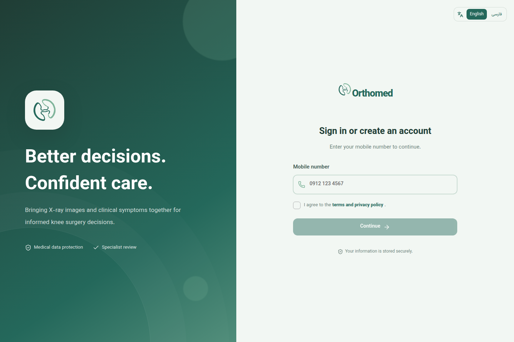
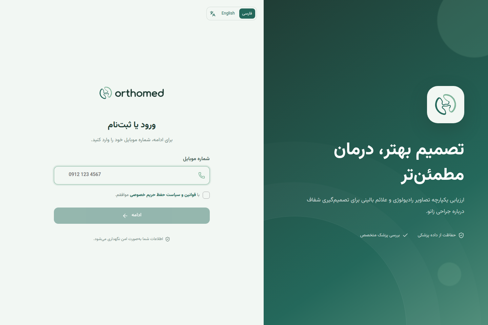

# Orthomed — Knee Surgery Assessment

A bilingual **English and Persian** platform for knee surgery assessment, connecting patients, doctors, and insurance reviewers. Built with React, TypeScript, and Django REST Framework.



## Features

- **English and Persian:** switch languages from the sign-in screen or application header. Your preference is saved in your browser; layouts switch between left-to-right and right-to-left.
- **Patient workspace:** register with a mobile verification code, manage your profile, record medical history, complete the 24-item WOMAC questionnaire, upload knee X-rays, and track cases.
- **Doctor workspace:** manage patients, review clinical and radiographic findings, record a Kellgren–Lawrence grade, and submit a medical assessment.
- **Insurance workspace:** review medical and AI assessments and record a surgical coverage decision.
- **Localized dates and catalogs:** Gregorian birth-date input in English, a Persian calendar in Persian, locale-aware date and number formatting, and searchable English/Persian medical catalogs.
- **Access controls:** role-based permissions, administrator approval for doctors and insurance reviewers, authenticated medical image access, and optional access auditing.

User-entered names, notes, and clinical assessments retain their original language. Switching the interface language does not translate clinical records or change saved medical values. The app currently uses Iranian mobile numbers and national IDs in both languages.

## Stack

| Layer | Technologies |
| --- | --- |
| Frontend | React, TypeScript, Vite, React Router, Lucide icons |
| Backend | Django, Django REST Framework, JWT authentication |
| Database | SQLite |
| Optional services | SMS.ir for SMS, an OpenAI-compatible API for AI assessment, GeoIP for access auditing |
| Deployment | Docker Compose; Nginx and Gunicorn production templates |

## Run locally

Requirements: **Node.js 22.12 or newer** and **Python 3.12 or newer**.

```bash
git clone https://github.com/shosseinj/orthomed-knee-assessment.git
cd orthomed-knee-assessment
cp .env.example .env
python3 -m venv .venv
source .venv/bin/activate
python -m pip install --upgrade pip
pip install -r backend/requirements.txt
python backend/manage.py migrate
python backend/manage.py runserver 0.0.0.0:8000
```

In another terminal:

```bash
cd frontend
npm ci
npm run dev
```

The frontend binds to **`0.0.0.0:5173`** and the backend to **`0.0.0.0:8000`**. Open [http://localhost:5173](http://localhost:5173) on this machine, or `http://<your-machine-ip>:5173` from another device on the same network. `0.0.0.0` is the listen address, not an Internet hostname.

The frontend proxies `/api` and `/media` to the backend, so browsers on other devices do not need a separate API address. These commands run the development environment; use the production templates for an HTTPS deployment.

Create an administrator account when needed:

```bash
source .venv/bin/activate
python backend/manage.py createsuperuser
```

Django Admin is available at [http://localhost:8000/admin/](http://localhost:8000/admin/). Doctor and insurance accounts require administrator verification before they can access cases.

## Run with Docker

```bash
cp .env.example .env
docker compose up --build
```

Open [http://localhost:5173](http://localhost:5173). Both services listen on all network interfaces. Docker configures the frontend proxy to use the backend container automatically.

## Development authentication

With `OTP_BACKEND=console`, verification codes are printed in the backend terminal; no SMS is sent. With `ENABLE_MOCK_OTP=true`, test numbers beginning with `0950` accept the fixed code `12345`. New users still complete registration and identity fields. Set `ENABLE_MOCK_OTP=false` for real deployments.

## Configuration

Copy `.env.example` to `.env`; keep real credentials out of Git.

| Variable | Purpose |
| --- | --- |
| `DJANGO_SECRET_KEY` | Django secret; replace for deployment |
| `DJANGO_DEBUG` | Enables development behavior |
| `DJANGO_ALLOWED_HOSTS` | Hosts permitted by Django |
| `VITE_API_URL` | API base path; defaults to `/api/v1` |
| `API_PROXY_TARGET` | Optional development proxy target; defaults to `http://127.0.0.1:8000` |
| `OTP_BACKEND` | `console` for local development or `smsir` for SMS delivery |
| `ENABLE_MOCK_OTP` | Enables the development test-number flow |
| `SMSIR_API_KEY`, `SMSIR_TEMPLATE_ID` | SMS.ir credentials and template |
| `OPENAI_API_KEY`, `OPENAI_API_URL`, `OPENAI_MODEL` | AI analysis provider configuration |
| `ACCESS_AUDIT_PHONE_NUMBER` | Opt-in access auditing for one account |
| `GEOIP_CITY_DB_PATH` | Optional local GeoIP database |

Without AI credentials, AI analysis is unavailable; the interface does not fabricate clinical results.

## Validation

```bash
# Backend regression tests
.venv/bin/python backend/manage.py test apps.accounts apps.cases

# Frontend type checking and production build
cd frontend
npm run build

# Browser regression tests (install Chromium once)
npx playwright install chromium
npm run test:e2e
```

## Repository structure

```text
backend/                 Django API, accounts, cases, catalogs, and tests
frontend/src/            React application
frontend/src/i18n/       Locale state and English translations
frontend/public/         Brand assets and bundled Persian font
docs/images/             Actual English and Persian interface screenshots
docs/                    Architecture, access auditing, and deployment notes
deploy/                  Existing Nginx deployment template
```

<details>
<summary>Persian interface preview</summary>



</details>

## Production deployment

The existing [deployment guide](docs/DEPLOYMENT.md), `docker-compose.production.yml`, and `deploy/nginx-knee.conf` describe a specific server installation. Adapt its hostname, network, storage, and environment settings for your infrastructure. The production Compose template includes an explicit mock OTP test lane; disable it before handling real accounts.

Before clinical use, configure HTTPS, private medical file storage, backups, consent, retention policies, and account verification. AI output supports clinical review and requires clinical validation; it does not replace a qualified physician's diagnosis. Verify the WOMAC instrument's translation, validation, and licensing before clinical or insurance use.
