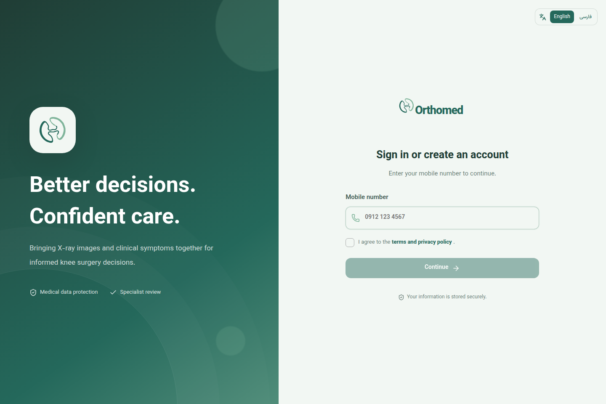
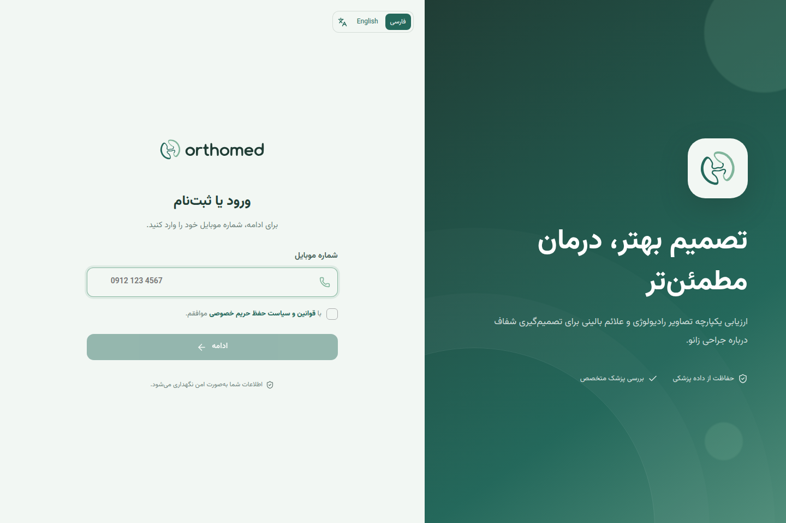

# Orthomed — Knee Surgery Assessment

A bilingual **English and Persian** platform for knee surgery assessment, connecting patients, doctors, and insurance reviewers. Built with React, TypeScript, and Django REST Framework.



## Features

- **English and Persian:** switch languages from the sign-in screen or application header. Your preference is saved in your browser; layouts switch between left-to-right and right-to-left.
- **Patient workspace:** register with a mobile verification code, manage your profile, record medical history, complete the 24-item WOMAC questionnaire, upload knee X-rays, and track cases.
- **Organized knee images:** optional right/left frontal and lateral slots, independent per-image AI classification, explicit human confirmation, replacement, and bilingual captions.
- **Doctor workspace:** manage patients, review clinical and radiographic findings, record a Kellgren–Lawrence grade, and submit a medical assessment.
- **Insurance workspace:** review medical and AI assessments and record a surgical coverage decision.
- **Localized dates and catalogs:** Gregorian birth-date input in English, a Persian calendar in Persian, locale-aware date and number formatting, and searchable English/Persian medical catalogs.
- **Access controls:** role-based permissions, administrator approval for doctors and insurance reviewers, authenticated medical image access, and optional access auditing.

User-entered names, notes, and clinical assessments retain their original language. Switching the interface language does not translate clinical records or change saved medical values. The app currently uses Iranian mobile numbers and national IDs in both languages.

## Stack

| Layer | Technologies |
| --- | --- |
| Frontend | React, TypeScript, Vite, React Router, Lucide icons |
| Backend | Django, Django REST Framework, JWT authentication |
| Database | SQLite |
| Optional services | SMS.ir for SMS, an OpenAI-compatible API for AI assessment, GeoIP for access auditing |
| Deployment | Docker Compose; Nginx and Gunicorn production templates |

## Run locally

Requirements: **Node.js 22.12 or newer** and **Python 3.12 or newer**.

```bash
git clone https://github.com/shosseinj/orthomed-knee-assessment.git
cd orthomed-knee-assessment
cp .env.example .env
python3 -m venv .venv
source .venv/bin/activate
python -m pip install --upgrade pip
pip install -r backend/requirements.txt
python backend/manage.py migrate
python backend/manage.py runserver 0.0.0.0:8000
```

In another terminal:

```bash
cd frontend
npm ci
npm run dev
```

The frontend binds to **`0.0.0.0:5173`** and the backend to **`0.0.0.0:8000`**. Open [http://localhost:5173](http://localhost:5173) on this machine, or `http://<your-machine-ip>:5173` from another device on the same network. `0.0.0.0` is the listen address, not an Internet hostname.

The frontend proxies `/api` and `/media` to the backend, so browsers on other devices do not need a separate API address. These commands run the development environment; use the production templates for an HTTPS deployment.

### Launch with one command

```bash
./run.sh
```

The runner works from any directory, creates `.env` from `.env.example` when missing, installs dependencies on first launch or when the dependency files change, applies database migrations, and starts both servers in the background on `0.0.0.0:5173` and `0.0.0.0:8000`. It returns control to your terminal after both servers are listening, and the project keeps running when you close the terminal. If your Node.js version is too old, it downloads and uses Node.js 22 through `npx`. Python 3.12 or newer and npm are required. When either port is occupied, the runner uses `lsof` to find and stop its listener, waits up to five seconds, and force-stops it if necessary before restarting the project. Processes owned by another user still require that user's permission to stop.

Run `./run.sh` again to restart after changing `.env` or backend code. To stop both servers or follow their logs:

```bash
./run.sh --stop
tail -f .run/backend.log .run/frontend.log
```

Logs are replaced on each launch and excluded from Git. If startup fails or takes longer than 30 seconds, the runner stops both new processes and reports the log directory.

### SMS.ir sign-in codes

Set these values in the root `.env` before requesting a sign-in or registration code:

```dotenv
OTP_BACKEND=smsir
ENABLE_MOCK_OTP=false
SMSIR_API_KEY=your-api-key
SMSIR_TEMPLATE_ID=your-numeric-template-id
SMSIR_CODE_PARAMETER=CODE
```

Use the ID of your approved SMS.ir verification template. `SMSIR_CODE_PARAMETER` must match the template's OTP placeholder name without `#` characters: for `#PARAMETER1#`, set it to `PARAMETER1`. Use a verification template with one code placeholder; the website generates a random five-digit code for that parameter. The backend sends the request to SMS.ir's [`POST /v1/send/verify` endpoint](https://api.sms.ir/swagger/index.html), with the API key in the `x-api-key` header. The key stays on the backend.

Choose **Patient**, **Doctor**, **Insurance company**, or **Admin**, then enter a mobile number to receive a code; no terms checkbox is required. The backend verifies the code before looking up the account. If the selected role is already registered, the user signs in to that role. Otherwise, they complete registration for that role without another code, even if the number already has another role. For example, an existing patient can register as a doctor using the same phone and national ID; the patient account and its cases remain intact. Known identity fields are prefilled and preserved. Doctors provide a medical council number and insurance users provide an organization name. Each role has its own approval and activation status.

The signed registration token binds the verified phone, selected role, and existing identity ID (when adding a role), expires after 15 minutes, and cannot be reused to sign in or register another role. Account status is not disclosed before verification. JWT access and refresh tokens carry the active role; the backend checks current registration, approval, activation, and administrative permission on subsequent requests. Refreshing a token keeps its role. To enter another role, sign out and select it on the entry page. Older API clients that omit `entry_role` enter the account's original role (or administration for an authorized manager).

**Admin** entry signs existing administrators in after phone verification. When `ADMIN_REGISTRATION_PASSWORD_HASH` is configured, users who have not registered as an administrator can complete signup after verifying their phone and entering the administrator registration password. The backend checks that password against its configured Django hash, stores the account password as a hash, and grants only `accounts.manage_account_verifications` with staff status; it does not grant superuser or user-editing permissions. An existing patient/doctor/insurance identity can add the admin role without changing its other registrations. Five admin-registration requests per minute per IP are allowed. Clearing the setting disables further admin registration; existing administrators can still sign in. Doctor and insurance registration still requires administrator approval before clinical access.

After sign-in, the account role is visible in the application header on desktop and mobile, in the sidebar, and in the profile. Labels use the server-provided role and account-management permission; administrators are labelled **System administrator** and enter account management, while patients, doctors, and insurance reviewers enter their dashboard. Doctor and insurance accounts awaiting approval keep their role label while access remains restricted.

| Active role | Workspace capabilities |
| --- | --- |
| Patient | Create and track their own cases, edit draft history and WOMAC answers, upload images, and manage personal identity details. Medical and AI assessment details remain hidden. |
| Approved doctor | Manage assigned patients, create their cases, review submitted cases, request AI analysis, and record medical assessments. |
| Approved insurance reviewer | Review cases awaiting coverage decisions and completed cases, read clinical assessments, and record insurance decisions. Case creation and medical-assessment tools are unavailable. |
| Administrator | Search, approve, reactivate, and revoke doctor/insurance role registrations independently. Clinical case routes are unavailable in the admin session. |

Migration `accounts/0006_role_registrations` copies every existing user's original role and approval into a role-registration record without changing user IDs, cases, images, or national-ID uniqueness. Primary registrations retain the user ID as their management ID; additional registrations have independent IDs. Original user role fields remain for existing integrations, while API authorization uses the role bound to the session. A doctor/insurance approval applies only to that registration, and a patient's session cannot use admin permissions even when the same identity also has admin access. Django Admin can inspect role registrations; the account's global activation remains separate from each role's activation.

Codes expire after two minutes and can be used once. If configuration is missing or SMS.ir rejects the request, the website shows a delivery error and the failed challenge is removed unless manual sign-in is configured. The environment example enables SMS.ir delivery, so enter your credentials before using sign-in. To develop without sending SMS, explicitly set `OTP_BACKEND=console` and `ENABLE_MOCK_OTP=true` with `DJANGO_DEBUG=true`.

For an optional shared manual sign-in code, set `OTP_MANUAL_CODE_HASH` to its Django password hash in the server's `.env`, single-quoted to preserve `$` characters. Generate it with `getpass` and `django.contrib.auth.hashers.make_password` rather than keeping the code in source or frontend configuration. Empty disables manual sign-in. SMS delivery is still attempted first; users can enter either the SMS code or the manual code in the same verification field. If SMS delivery fails while manual sign-in is enabled, the screen reports that failure and allows the manual code. The manual code requires a new request for that phone, uses the same two-minute lifetime and five-attempt limit, and consumes the challenge just like an SMS code. Only the latest request can be verified. Registration, role selection, account activation and administrator signup checks still apply. This shared code grants access without proving possession of the phone, so distribute it only to people authorized to use that fallback; clear the hash to disable it. Neither the code nor its hash is returned to the browser.

If SMS.ir delivery returns HTTP 503, check the backend log for the upstream HTTP status, numeric provider status, or network error type. The API key, recipient, and verification code are omitted from these diagnostics. The template ID must belong to the account associated with your API key, be approved for use, and contain the configured code parameter. You can check credit and templates without sending SMS using SMS.ir's `GET /v1/credit` and `GET /v1/templates` APIs.

Create an administrator account when needed:

```bash
source .venv/bin/activate
python backend/manage.py createsuperuser
```

The app's **System administrator** page is available at [http://localhost:5173/management](http://localhost:5173/management). Sign in through the normal verification-code flow with an administrator account. Administrators can search doctor and insurance accounts, filter by approval status, approve/activate accounts, and revoke approval. A doctor's existing session can use the **Check approval status** button after approval; a new login is not required. Account changes are recorded in Django's admin log.

Superusers created with `createsuperuser` can access this page. To grant only account-verification management to an existing registered account, run this locally, substituting that account's mobile number:

```bash
python backend/manage.py grant_account_manager <registered-mobile-number>

.venv/bin/python backend/manage.py grant_account_manager 09XXXXXXXXX
```

This grants the dedicated `accounts.manage_account_verifications` permission, without superuser access or permission to edit account roles. Administrator access can also be registered through the password-protected Admin signup described above; the account-approval page cannot grant it. Django Admin remains available at [http://localhost:8000/admin/](http://localhost:8000/admin/).

## Run with Docker

```bash
cp .env.example .env
docker compose up --build
```

Open [http://localhost:5173](http://localhost:5173). Both services listen on all network interfaces. Docker configures the frontend proxy to use the backend container automatically.

## Development authentication

With `DJANGO_DEBUG=true`, `OTP_BACKEND=console`, and `ENABLE_MOCK_OTP=true`, all mobile numbers use the development verification code **`11111`** without sending SMS. The sign-in screen shows the configured development code. Request a new code before entering it; codes still expire and can only be used once. New users still complete registration and identity fields. With `DJANGO_DEBUG=false`, fixed development codes are disabled, even if the mock flag is enabled. Configure the production OTP provider and set `ENABLE_MOCK_OTP=false` for deployment.

## Configuration

Copy `.env.example` to `.env`; keep real credentials out of Git.

| Variable | Purpose |
| --- | --- |
| `DJANGO_SECRET_KEY` | Django secret; replace for deployment |
| `DJANGO_DEBUG` | Enables development behavior |
| `DJANGO_ALLOWED_HOSTS` | Hosts permitted by Django |
| `VITE_API_URL` | API base path; defaults to `/api/v1` |
| `API_PROXY_TARGET` | Optional development proxy target; defaults to `http://127.0.0.1:8000` |
| `OTP_BACKEND` | `console` for local development or `smsir` for SMS delivery |
| `ENABLE_MOCK_OTP` | Enables the development test-number flow |
| `OTP_MANUAL_CODE_HASH` | Optional Django hash of a shared manual sign-in code; empty disables fallback. Single-quote the hash to preserve `$` characters. |
| `ADMIN_REGISTRATION_PASSWORD_HASH` | Django hash for the admin signup password; empty disables admin signup. Store it in server configuration, single-quoted to preserve `$` characters. |
| `SMSIR_API_KEY`, `SMSIR_TEMPLATE_ID` | SMS.ir API key and numeric verification template ID |
| `SMSIR_CODE_PARAMETER` | Template's OTP placeholder name, without `#`; defaults to `CODE` |
| `OPENAI_API_KEY`, `OPENAI_API_URL`, `OPENAI_MODEL` | AI analysis provider configuration |
| `OPENAI_ASSESSMENT_MAX_COMPLETION_TOKENS` | Assessment budget including internal reasoning and visible JSON; defaults to `8192`. An insufficient budget can return no visible answer. |
| `AI_SETTINGS_ENCRYPTION_SECRET` | Optional stable secret for personal API key encryption; defaults to `DJANGO_SECRET_KEY` |
| `ACCESS_AUDIT_PHONE_NUMBER` | Opt-in access auditing for one account |
| `GEOIP_CITY_DB_PATH` | Optional local GeoIP database |

Doctor sessions use the server's `OPENAI_API_KEY`, `OPENAI_API_URL`, and `OPENAI_MODEL`. Their case page has no API-key setup link, and Settings explains that the connection is managed by the application. Doctors cannot save or delete a personal key through the settings API; legacy personal records are ignored for doctor requests, including records that can no longer be decrypted. A missing or rejected server credential is reported as a service/support issue.

Other account roles can open **Settings → AI settings** and enter their own `OPENAI_API_KEY`. They can replace or remove it from the same page. The key is encrypted in the database for that account; the frontend receives only its last four characters and does not keep it in browser storage. Saving checks the key's format; OpenAI validates it when an analysis is requested. API requests run on the backend, following the [official OpenAI authentication guidance](https://developers.openai.com/api/reference/overview#authentication).

Outside doctor sessions, the requesting user's saved key takes precedence over the server's `OPENAI_API_KEY`. Removing it restores the server fallback, if configured. A patient's key is never used for another user's request. Keep the encryption secret stable across restarts; changing it requires users to re-enter their saved keys. Personal keys are separate from patient records and are not included in account or case API responses.

Without the applicable credential, AI analysis is unavailable and does not fabricate clinical results. Assessment responses must contain a completed, non-refused JSON object matching the expected fields and types; length-limited, empty, or malformed output is rejected before persistence. The configured token budget includes reasoning as well as visible output, as described in [OpenAI's Chat Completions reference](https://developers.openai.com/api/reference/resources/chat/subresources/completions/methods/create).

## Knee image organization and classification

Draft cases offer four optional slots: right frontal, right lateral, left frontal, and left lateral. Unilateral cases need only their relevant images; the existing minimum of one knee X-ray remains. Bilateral, unknown, other-view, and legacy images stay in a separate review area. Laboratory attachments retain their existing upload flow. “Frontal” does not assert AP versus PA; the historical `view` field is preserved.

Each new X-ray stores its declared side/view separately from independent AI detection and human confirmation. Every new image requires explicit confirmation before submission, even when AI agrees. An unknown side/view can be acknowledged with a reason for further review. Confirmation records the user, source, timestamp, and note; it never rewrites the declaration or original AI result. Submission locks image changes. Migration `0009` leaves existing files and historical views intact and initializes new metadata as unknown/pending without requiring retrospective confirmation.

The frontend uploads with progress, then calls authenticated `POST /api/v1/images/{image_id}/classify/`. `POST /api/v1/images/{image_id}/confirm/` accepts `{ "side": "right", "view": "frontal", "reason": "" }`. Supported sides are `right`, `left`, `bilateral`, `unknown`; views are `frontal`, `lateral`, `skyline`, `other`, `unknown`. The upload endpoint accepts `declared_side`, `declared_view`, and optional `replace_image_id`; replacement creates a new image ID and clears prior detection/confirmation. A unique database reservation and serialized case writes reject occupied slots, stale replacement targets, and concurrent duplicate assignments. Bilateral/unassigned images have no unilateral reservation.

Classification uses the requesting user's existing personal-key/server-key selection and `OPENAI_API_URL`/`OPENAI_MODEL`. Only stable IDs and image bytes enter its vision request; declarations, filenames, questionnaire answers, and upload order do not establish laterality. The backend validates result IDs, missing/duplicate results, types, enums, and contradictory marker/quality evidence. It preserves visible markers, reasons, quality, model/version, and timestamps. Request tokens discard late results after replacement, confirmation, newer retries, or submission. Failures retain the file and allow manual confirmation/retry. The clinical assessment receives each image with its stable ID and source-labelled metadata while retaining its existing response contract, grading, and recommendations.

This is a working provider integration, **not a clinically validated classifier**. Automated tests mock AI and demonstrate application behavior, not clinical detection accuracy. Classification is synchronous (up to a 120-second provider timeout); production workloads should use a task queue. The configured provider/model must support vision and the structured JSON schema. The interface presents uncertainty without a model-confidence accuracy claim.

## Validation

```bash
# Backend regression tests
.venv/bin/python backend/manage.py test apps.accounts apps.cases

# Frontend type checking and production build
cd frontend
npm run build

# Browser regression tests (install Chromium once)
npx playwright install chromium
npm run test:e2e
# Alternatively, use an installed Chromium:
PLAYWRIGHT_CHROMIUM_EXECUTABLE_PATH=/path/to/chromium npm run test:e2e
```

## Repository structure

```text
backend/                 Django API, accounts, cases, catalogs, and tests
frontend/src/            React application
frontend/src/i18n/       Locale state and English translations
frontend/public/         Brand assets and bundled Persian font
docs/images/             Actual English and Persian interface screenshots
docs/                    Architecture, access auditing, and deployment notes
deploy/                  Existing Nginx deployment template
```

<details>
<summary>Persian interface preview</summary>



</details>

## Production deployment

The existing [deployment guide](docs/DEPLOYMENT.md), `docker-compose.production.yml`, and `deploy/nginx-knee.conf` describe a specific server installation. Adapt its hostname, network, storage, and environment settings for your infrastructure. The production Compose template disables mock OTP.

Before clinical use, configure HTTPS, private medical file storage, backups, consent, retention policies, and account verification. AI output supports clinical review and requires clinical validation; it does not replace a qualified physician's diagnosis. Verify the WOMAC instrument's translation, validation, and licensing before clinical or insurance use.
